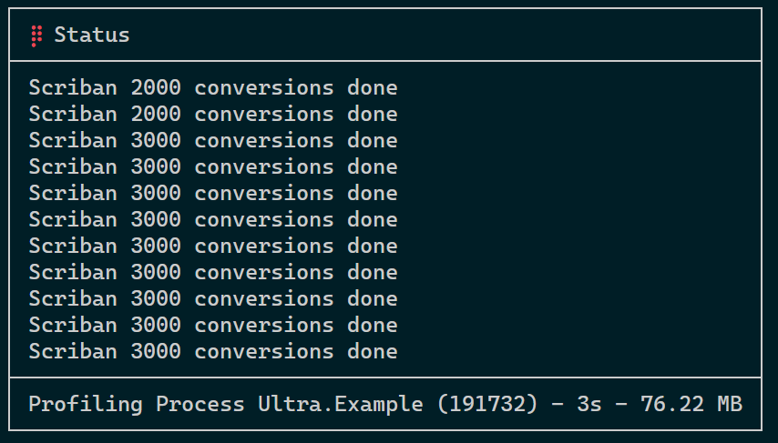
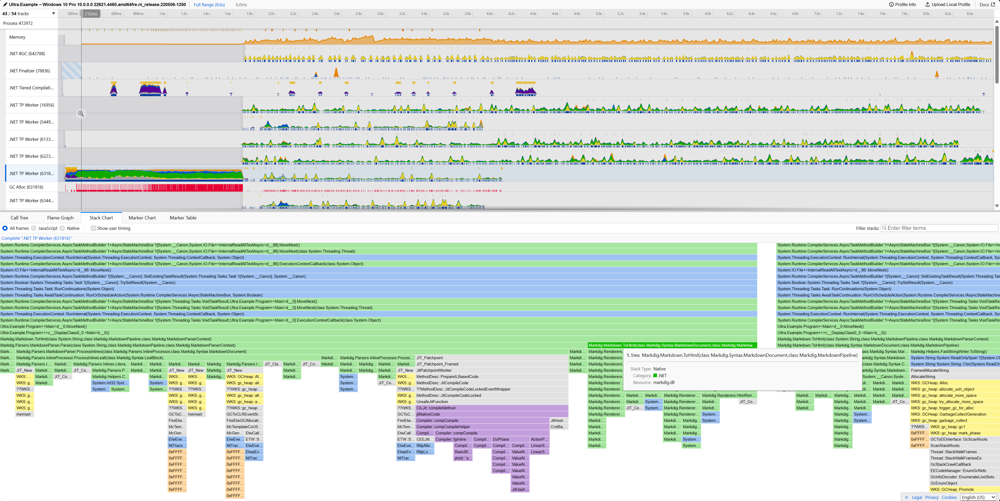
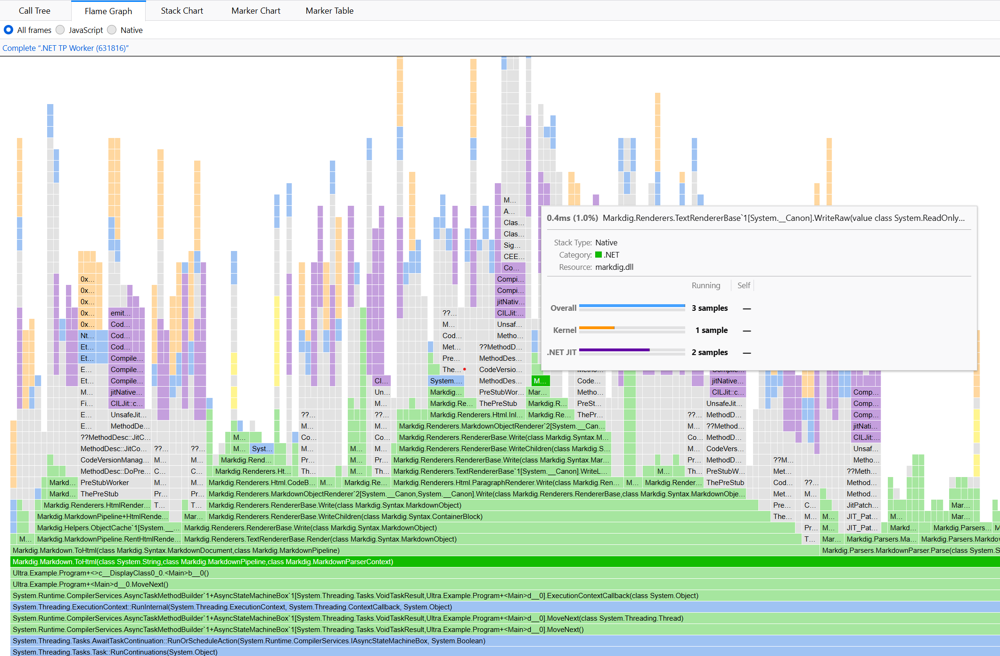
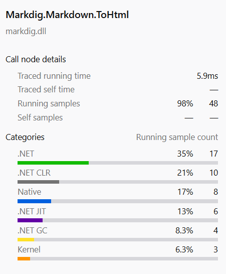
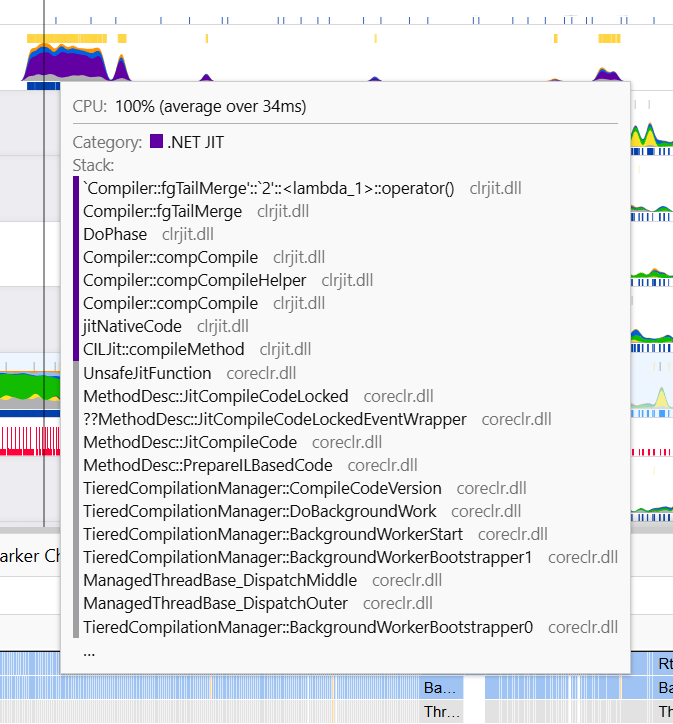
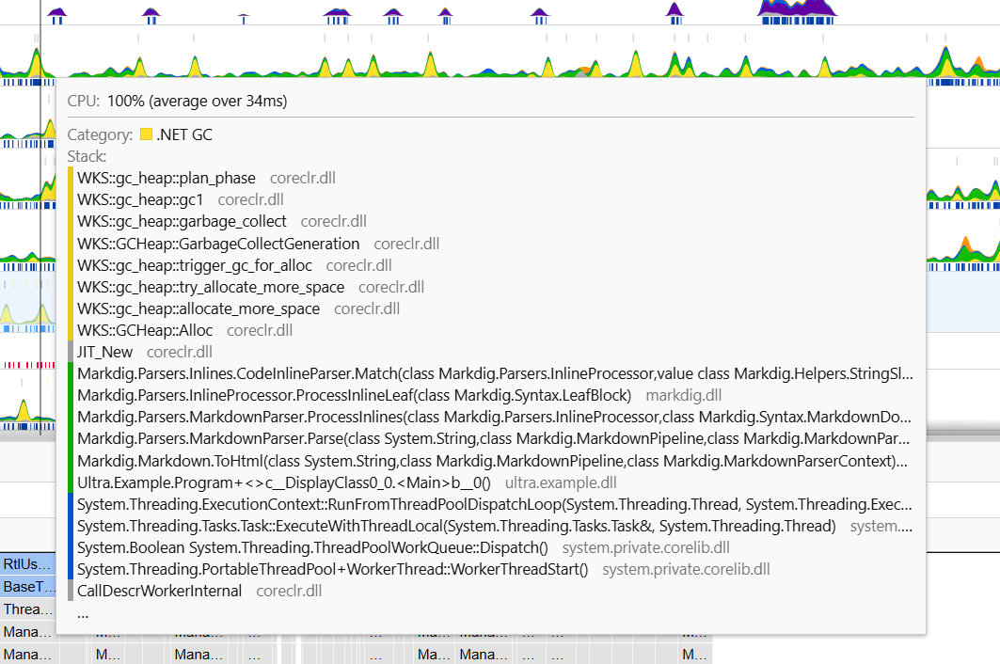
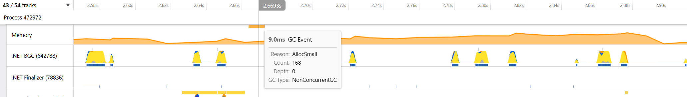
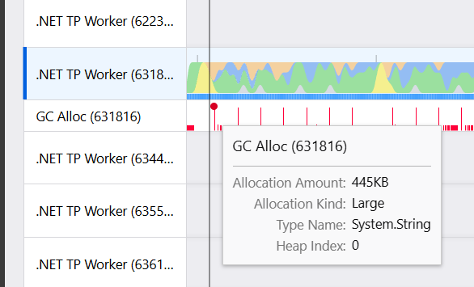
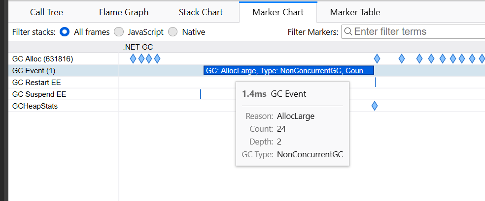

# Ultra User Guide

## Quick Start

> ____
> 🚨 The profiler **requires to run from an elevated prompt with administrative rights** (Windows) or **as root** (Linux) 🚨 
>
> _This is required to allow to collect full stack traces, including kernel and native functions._
> ____

Example: open a **terminal with administrative rights**, to profile an executable called `my_commands.exe`:

```console
$ ultra.exe profile -- my_command.exe arg0 arg1 arg2...
```

This will create a `ultra_my_command_..._.json.gz` trace file in the current directory.

From a terminal without administrative rights (or from a script or an AI agent), add `--elevate` on Windows: ultra asks for the rights with a UAC prompt and runs the profiling in an elevated ultra, whose progress, exit code and program output are relayed to your terminal. CTRL+C still stops it, and a program launched after `--` still runs as you, not elevated:

```console
$ ultra.exe profile --elevate -- my_command.exe arg0 arg1 arg2...
```

By default, ultra won't show the stdout/stderr of the program launched. You can change this behavior by specifying the `--mode` option:

- `silent` (default): won't mix program's output
- `raw`: will mix ultra and program output together in a raw output. Ultra output will be prefixed at the start of a line with `>>ultra::`
- `live`: will mix ultra and program output within a live table

For example, a profile with `live` mode:

```console
$ ultra.exe profile --mode live -- my_command.exe arg0 arg1 arg2...
```

will display the following live table when running your process:



When attaching an existing process, you can pass directly a PID to ultra.exe:

```console
$ ultra.exe profile 12594 # PID of the process to profile
```

Several processes can be profiled in one session, each into its own `json.gz` file:

```console
$ ultra.exe profile --pid 12594,13320
```

> ⚠️ You will need to press only once `CTRL+C` to stop the profiling - or if the application is closed.

## Linux

On Linux, ultra records the CPU samples, call stacks and context switches with the kernel's perf events
(`perf_event_open`, the same source as `perf record`) and the .NET runtime events (GC, JIT, method names) with an
EventPipe session, so both launching a program and attaching to running processes work:

```console
$ sudo ultra profile --pid 12594,13320
$ sudo ultra profile -- ./my_command arg0 arg1
```

A normal (RID-less) build of ultra made on Windows also holds a Linux launcher, `ultra` beside `ultra.exe`, so the build folder copied to a Linux box with the .NET runtime runs as `./ultra` (give it the execute bit when the copy lost it: `chmod +x ultra`); a self-contained publish (`dotnet publish -r linux-x64 --self-contained`) needs no runtime at all.

Requirements:

- root (`sudo`), or `kernel.perf_event_paranoid` set to `0` or lower (`sysctl kernel.perf_event_paranoid=-1`);
- a kernel with perf events (any recent kernel; build ids of the loaded libraries need 5.12 or later);
- for complete native stacks, libraries compiled with frame pointers (the .NET runtime and JIT'd code always have them; Ubuntu 24.04 and Fedora 38 or later build their packages with them).

What is resolved:

- .NET methods (JIT'd code) from the runtime's method events, kernel functions from `/proc/kallsyms`, and the exported functions of the native libraries from their ELF symbol tables;
- functions inside stripped libraries (`libc.so.6`, `libcoreclr.so`...) that are not exported show as `library!0xADDRESS`, like `perf` without debug symbols;
- precompiled (ReadyToRun) framework code shows as `System.Private.CoreLib.dll!0xADDRESS`.

Hardware counters can be sampled besides the CPU time with `--pmc`: each counter adds a `[name]` track under every thread, whose call tree shows where the counter events happen (the samples are weighted by their counts):

```console
$ sudo ultra profile --pmc cycles,cache-misses,LLC-load-misses --pid 12594
$ sudo ultra profile --pmc r0843:20000 -- ./my_command   # a raw CPU event, one sample every 20000 events
```

`ultra profile --pmc list` prints the accepted names. By default the kernel adapts the period of a counter to about 4000 samples per second per CPU (`--pmc-frequency` changes that); `NAME:PERIOD` samples every PERIOD events instead. The generic names (`cycles`, `instructions`, `cache-references`, `cache-misses`, `branches`, `branch-misses`, `L1-dcache-load-misses`, `LLC-load-misses`, `dTLB-load-misses`, `iTLB-load-misses`...) are mapped by the kernel to the events of the CPU; `rHEX` is the raw event code of the CPU as in `perf stat -e rHEX` (on x86: umask then event number, so AMD's `PMCx043` with umask `0x08` is `r0843`). Virtual machines usually do not expose the counters.

The recording is written to `ultra_<name>_<time>.ultraperf` (perf events) plus one `..._<pid>_clr.nettrace` file per .NET process; they are deleted after the conversion unless `--keep-intermediate-etl-files` is passed. Such files can be converted again, on any machine (the symbols of the native libraries are only available on the recording machine):

```console
$ ultra convert --pid 12594 ultra_my_command_2026-10-30_15_23_46.ultraperf
```

## Hardware counters on Windows

`--pmc` works on Windows too, through the ETW profile sources of the machine (the counters `wpr -pmcsources` lists). The tracks are the same as on Linux: a `[name]` track under every thread, its samples weighted by the counter events they stand for.

```console
> ultra profile --pmc list
> ultra profile --pmc InstructionRetired,TotalCycles,DcacheAccesses,BranchMispredictions --pid 12594
> ultra profile --pmc cycles,branch-misses:8192 -- my_command.exe
```

- The names are the sources of the machine (`TotalCycles`, `InstructionRetired`, `DcacheAccesses`, `DcacheMisses`, `CacheMisses`, `BranchMispredictions`, `ICMiss`...), in any case; the Linux names `cycles`, `instructions`, `branches`, `branch-misses`, `cache-misses`, `L1-dcache-load-misses`, `L1-dcache-loads` and `L1-icache-load-misses` are accepted too.
- `NAME:INTERVAL` takes a sample every INTERVAL counter events. The default is 65,536 for the miss counters and 1,000,000 for the counters that count at about the clock rate (cycles, instructions, accesses), about 5,000 samples per second per busy core at 5 GHz. There is no adaptive frequency on Windows, `--pmc-frequency` is Linux only.
- The CPU counts a few sources at once (4 to 6); with more, the profiling fails at once with the reason.
- Some listed sources never count on some machines (e.g. `DcacheMisses` and `CacheMisses` on a Zen 5 under Hyper-V): ultra warns when a counter gave no samples. L2, L3 and TLB counters have no source on Windows.
- The hardware counters need the classic `NT Kernel Logger` session, of which there is one per machine: if another tool (WPR, PerfView, xperf) holds it, ultra warns and stops that session.

## Ultra Profiler UI

In order to visualize a trace produced by `ultra.exe` you need to go to https://profiler.firefox.com/ and open the generated `json.gz` trace file.

> :notebook: **Note**
> 
> When loading a trace with the Firefox Profiler, the trace won't be uploaded to a server but only processed locally in your browser, so **the UI is completely offline**.
> 
> It is only if you want to share the trace with a link that it will upload it to a server. But you can also share the trace file directly.

### Timeline

This screenshot shows a profile captured with ultra and is available online [here](https://share.firefox.dev/3Cya7YW)

You have access to several capabilities:
- Zoom in a timeline
- When in the Flame Graph / Stack Chart, you can hold `SHIFT + MouseWheel` to zoom-in / zoom-out



### Flame Graph / Stack Chart

The Flame Graph / Stack Chart is a visualization of the time spent in functions. The width of the boxes is proportional to the time spent in the function. The boxes are stacked to show the call hierarchy.



### Categories

When selecting functions, you can visualize the split between the time in the different modules:

- `.NET`: Managed code (user or BCL)
- `.NET JIT`: Functions participating in the JIT to compile methods
- `.NET GC`: Functions participating in the GC
- `.NET CLR`: Functions used by the CoreCLR runtime
- `Native`: Native functions
- `Kernel`: Kernel functions - displayed with hexadecimal address

The colors are reflected in the Flame Graph / Stack Chart to easily spot the different usage.



While hovering the mouse over a function, you can see the time spent in the function and the categories:

Here is an example of a function in the `JIT` category:




Here is an example of a function in the `GC` category:



### Memory Track

The memory track shows the managed memory usage of the process. You can see the memory usage over time.



### GC Allocation Track

The GC Allocation Track shows the allocation rate of the process. You can see the allocation rate over time.



### JIT and GC Markers

The JIT and GC markers are displayed in the timeline. You can see the JIT and GC events in the timeline.

You can also see them in the Marker Chart and Marker Table view.



## Ultra Command Line

ultra.exe command line options (`ultra <command> --help` for the options of a command):

```console
Usage: ultra [Options] command

  -h, -?, --help             Show this message and exit
  -v, --version              Show the version of this command
      --verbose              Display verbose progress

Available commands:
  profile                    Profile a new process or attach to an existing process
  convert                    Convert an existing trace file (one ETL file, a Linux .ultraperf file with its CLR .
                               nettrace files, or a list of nettrace files) to a Firefox Profiler json file
  report                     Print a text report of a Firefox Profiler json file written by ultra: the CPU per thread,
                               the top functions, the hardware counters per function. Streams the file: fine for a
                               trace of hundreds of MB.
  mcp                        Run the ultra MCP server (Model Context Protocol, stdio): AI agents capture profiles and
                               analyze them with its tools
  guide                      Print the guide for AI agents and automation: capture a profile, read the result, analyze
                               it (report, MCP tools)

Automation and AI agents:
  ultra guide                       The workflow for agents and scripts: capture, results, analysis, MCP
  ultra profile --elevate --duration 30 --result-file result.json --pid 1234
                                    Capture from a non-admin shell (Windows UAC prompt), JSON summary
  ultra report <profile.json.gz>    Text overview of a profile: CPU per thread, top functions
  ultra mcp                         MCP server (stdio) to capture and analyze profiles from an agent
```

### Profile

This is the main command to profile an application - it requires an elevated prompt on Windows, or `--elevate` to ask for it:

```console
Usage: ultra profile [Options] <pid | -- execName arg0 arg1...>

  -h, -?, --help             Show this message and exit
  -o, --output=FILE          The base output FILE name. Default is ultra_<process_name>_yyyy-MM-dd_HH_mm_ss.
      --pid=PID              The PID of the process to attach the profiler to. Several pids can be separated by commas (
                               or the option repeated): each process gets its own json file.
      --sampling-interval=VALUE
                             The VALUE of the sample interval in ms. Default is 0.122ms (8190Hz).
      --symbol-path=VALUE    The VALUE of symbol path. The default value is `;SRV*C:\Users\alexa\AppData\Local\Temp\
                               SymbolCache*https://msdl.microsoft.com/download/symbols;SRV*C:\Users\alexa\AppData\Local\
                               Temp\SymbolCache*https://symbols.nuget.org/download/symbols`.
      --pmc=NAME             Linux and Windows: hardware counters to sample besides the CPU time, comma separated NAME[:
                               INTERVAL]. Each counter adds a `[name]` track per thread, weighted by the counts. On
                               Windows the names are the ETW profile sources of the machine (e.g. DcacheMisses,
                               CacheMisses, BranchMispredictions, TotalCycles; the Linux names cycles, cache-misses, L1-
                               dcache-load-misses... are accepted too) and INTERVAL is the counter events between two
                               samples. `--pmc list` prints the counters of this machine.
      --pmc-frequency=VALUE  Linux only: the samples per second per CPU the kernel aims at for a --pmc counter given
                               without a period. Default is 4000.
      --paused               Launch the profiler paused and wait for SPACE or ENTER keys to be pressed.
      --delay=VALUE          Starts profiling after a specific delay (seconds). Default is 0s.
      --duration=VALUE       Run the profiler for a maximum duration (seconds). Default is 120s
      --keep-merged-etl-file Keep the merged ETL file. Without it (and without --nofilter) the ETL files are not merged:
                                the profile is converted from the unmerged files directly.
      --keep-intermediate-etl-files
                             Keep the intermediate trace files: the ETL files before merging, or on Linux the .
                               ultraperf and CLR .nettrace files.
      --nofilter             Windows only: convert the full merged ETL file. By default only the CPU samples, stacks
                               and context switches of the profiled process(es) are converted, which is much faster on
                               a busy machine.
      --mode=VALUE           Defines how the stdout/stderr of a program explicitly started by ultra should be
                               integrated in its output. Default is `silent` which will not mix program's output. The
                               other options are: `raw` is going to mix ultra and program output together in a raw
                               output. `live` is going to mix ultra and program output within a live table.
  [args]...                  Exec to launch with arguments passed

Automation (scripts, AI agents):
      --elevate              Windows only: when ultra does not run as administrator, ask for it with a UAC prompt and
                               run the profiling in an elevated ultra. Its progress, the output of the program and its
                               exit code are relayed to this console, CTRL+C still stops it. A program launched after --
                                still runs as the current user, not elevated.
      --result-file=FILE     Write a JSON summary to FILE when the command ends: success, exitCode, error, stopped and
                               the profiles written (path, size). The way for a script or an agent to find the json.gz
                               files.
      --stop-file=FILE       Stop profiling as soon as FILE exists (created by another process): the profile is still
                               converted and written, like with CTRL+C. The file is deleted at start if it exists.

Examples:
  ultra profile --duration 10 -- my_app.exe arg0     Launch my_app.exe and profile its first 10 seconds
  ultra profile --pid 1234,5678                      Attach to running processes until they exit (or 120s)
  ultra profile --elevate --duration 30 --result-file result.json --pid 1234
                                                     From a non-admin shell or an agent (Windows)
```

### Convert

Convert an existing trace (a Windows ETL file, a Linux .ultraperf file with its CLR .nettrace files, or macOS nettrace files) to a Firefox Profiler json file:

It requires a list of PID in order to only produce results for these processes. 

```console
Usage: ultra convert --pid xxx [<etl_file_name.etl> | <trace.ultraperf> [<trace_pid_clr.nettrace>] | <file1_sampler.
nettrace> <file1_clr.nettrace>]

  -h, -?, --help             Show this message and exit
  -o, --output=FILE          The base output FILE name. Default is the input file name without the extension.
      --pid=PID              The PID of the process. Several pids can be separated by commas (or the option repeated):
                               each process gets its own json file.
      --symbol-path=VALUE    The VALUE of symbol path. The default value is `;SRV*C:\Users\alexa\AppData\Local\Temp\
                               SymbolCache*https://msdl.microsoft.com/download/symbols;SRV*C:\Users\alexa\AppData\Local\
                               Temp\SymbolCache*https://symbols.nuget.org/download/symbols`.
      --nofilter             ETL only: convert the full ETL file. By default only the CPU samples, stacks and context
                               switches of the --pid process(es) are converted, which is much faster on a busy machine;
                               that filtered .etlx file is kept next to the ETL file and reused.
      --result-file=FILE     Write a JSON summary to FILE when the command ends (see `ultra profile --help`).
  [args]...                  The trace file(s) to convert
```

### Report

A text summary of a trace, for a quick look or for a tool that cannot load a big profile (a 150 MB trace of a 2 minute run on 12 cores takes a few seconds):

```console
Usage: ultra report [Options] <profile.json.gz>

  -h, -?, --help                    Show this message and exit
      --top=VALUE                   How many threads and functions to list. Default is 12.
      --offsets                     Also the hot code offsets of the top 3 functions (where in a function's code the
                                      samples are).
      --thread=TEXT                 Only the threads whose name contains TEXT.
      --workers=VALUE               The parsing threads. Default is half the processors.
```

It prints the CPU time of each thread and its share of the process, the top leaf functions over all threads, and for each hardware counter of `--pmc` its events per function. The `[counter]` tracks are reported apart from the CPU threads: a plain sum over all the threads of the file would count them as CPU time.

### MCP server

`ultra mcp` runs an MCP (Model Context Protocol) server on stdio, for AI coding agents. Configure your agent with a stdio server whose command is `ultra` with the argument `mcp`:

- Claude Code: `claude mcp add ultra -- ultra mcp`
- VS Code (`.vscode/mcp.json`): `{ "servers": { "ultra": { "type": "stdio", "command": "ultra", "args": ["mcp"] } } }`

Its tools:

- capture, as background jobs of the ultra command line: `find_processes`, `start_profiling` (pids, or a program to launch), `start_conversion`, `get_job_status` (waits for the end of a job and lists the profile files written), `stop_job` (stops a capture early, the profile is still written), `list_jobs`. On Windows, `start_profiling` shows a UAC prompt to the user when the server does not run as administrator. Unless the job is given a `workingDirectory` or an `output`, the profiles are written in `%LOCALAPPDATA%\ultra\profiles` (Windows) or `~/.local/share/ultra/profiles`, and a conversion writes them next to its trace;
- analysis of the `json.gz` profiles: `get_profile_report` (the `ultra report` overview), `load_profile`, `get_profile_summary`, `list_threads`, `call_tree`, `call_tree_inverted`, `find_hotspots`, `focus_function`, `module_breakdown`, `top_functions`, `list_samples`, `get_sample`, `get_call_stack`, `query_markers`, `list_counters`, `counter_samples`, and `get_llm_guide` (the field manual of the format for the agent).

The analysis tools come from [UltraMcp](https://github.com/KirillOsenkov/UltraMcp) by Kirill Osenkov (MIT license, see [THIRD-PARTY-NOTICES.txt](../src/Ultra.Mcp/THIRD-PARTY-NOTICES.txt)).

## Automation and AI agents

`ultra guide` prints the guide for AI agents and scripts: how to capture, read the result and analyze a profile.

- When its output is redirected, ultra prints plain lines (no live display): the steps, and the status every few seconds.
- `--result-file result.json` writes a JSON summary when `profile` or `convert` ends, success or failure:

  ```json
  {
    "version": 1,
    "command": "profile",
    "success": true,
    "exitCode": 0,
    "stopped": false,
    "elevated": true,
    "startTime": "2026-10-31T10:12:00+01:00",
    "durationSeconds": 42.1,
    "profiles": [ { "path": "C:\\work\\ultra_my_app_2026-10-31_10_12_00_pid_1234.json.gz", "size": 12345678 } ]
  }
  ```

  On failure, `success` is `false` and `error` gives the reason. The exit code of ultra is 0 when the profile was written, 1 otherwise.
- `--stop-file stop.txt` stops the profiling as soon as the file exists, like CTRL+C: the profile is still converted and written. This is how a script stops a capture running in the background.
- `--elevate` (Windows) asks for the administrator rights with a UAC prompt, so that a non-elevated script or agent can profile.

For example, from a script that runs the scenario to profile in between:

```console
$ ultra profile --elevate --duration 60 --result-file result.json --stop-file stop.txt --pid 1234   # in the background
$ ... run the scenario ...
$ echo > stop.txt                                                                                 # stop: the profile is written
```
