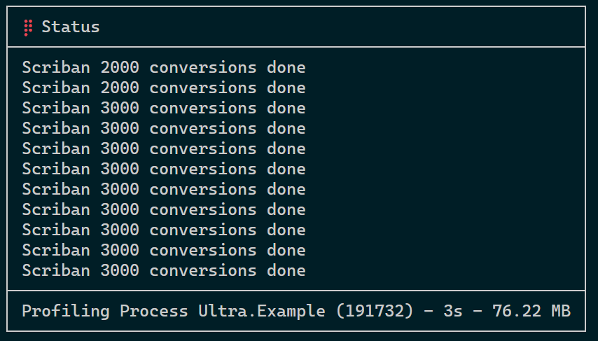
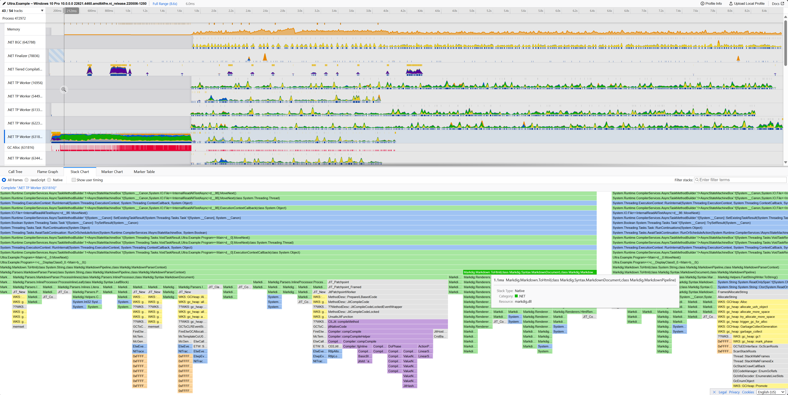
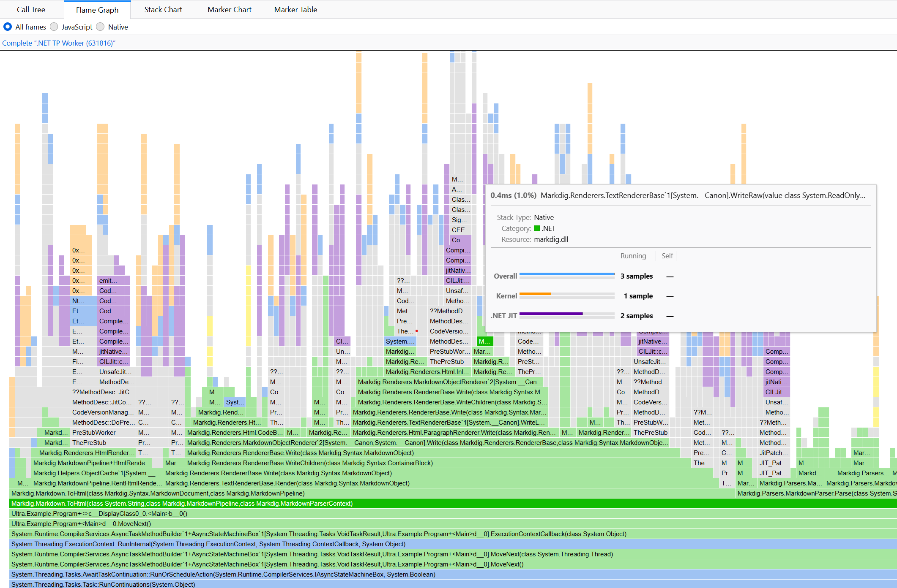
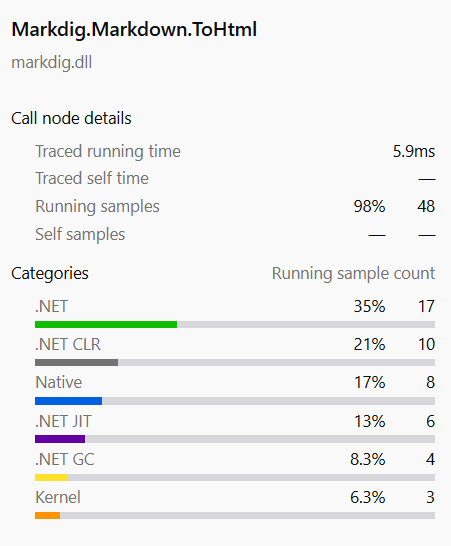
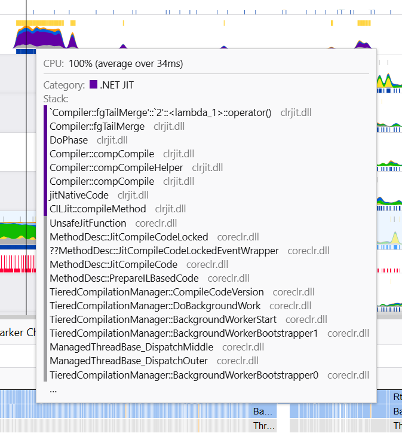
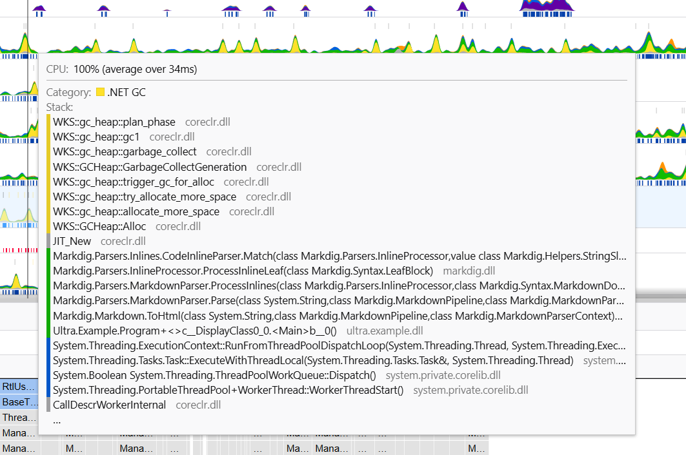
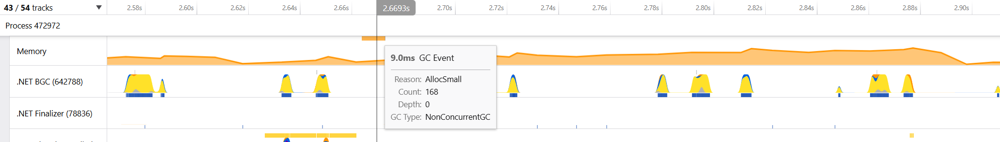
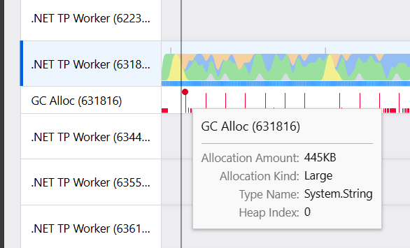
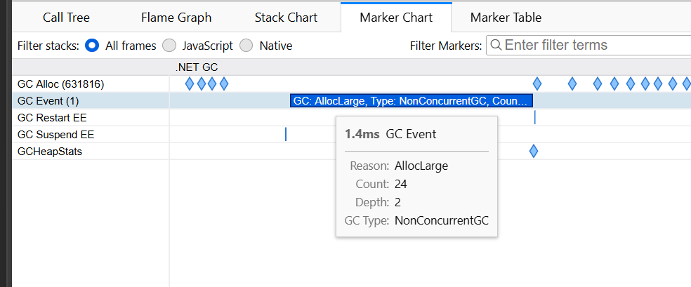

# Ultra User Guide

## Quick Start

> ____
> 🚨 The profiler **requires to run from an elevated prompt with administrative rights** (Windows) or **as root** (Linux) 🚨 
>
> _This is required to allow to collect full stack traces, including kernel and native functions._
> ____

Example: open a **terminal with administrative rights**, to profile an executable called `my_commands.exe`:

```console
$ ultra.exe profile -- my_command.exe arg0 arg1 arg2...
```

This will create a `ultra_my_command_..._.json.gz` trace file in the current directory.

By default, ultra won't show the stdout/stderr of the program launched. You can change this behavior by specifying the `--mode` option:

- `silent` (default): won't mix program's output
- `raw`: will mix ultra and program output together in a raw output. Ultra output will be prefixed at the start of a line with `>>ultra::`
- `live`: will mix ultra and program output within a live table

For example, a profile with `live` mode:

```console
$ ultra.exe profile --mode live -- my_command.exe arg0 arg1 arg2...
```

will display the following live table when running your process:



When attaching an existing process, you can pass directly a PID to ultra.exe:

```console
$ ultra.exe profile 12594 # PID of the process to profile
```

Several processes can be profiled in one session, each into its own `json.gz` file:

```console
$ ultra.exe profile --pid 12594,13320
```

> ⚠️ You will need to press only once `CTRL+C` to stop the profiling - or if the application is closed.

## Linux

On Linux, ultra records the CPU samples, call stacks and context switches with the kernel's perf events
(`perf_event_open`, the same source as `perf record`) and the .NET runtime events (GC, JIT, method names) with an
EventPipe session, so both launching a program and attaching to running processes work:

```console
$ sudo ultra profile --pid 12594,13320
$ sudo ultra profile -- ./my_command arg0 arg1
```

A normal (RID-less) build of ultra made on Windows also holds a Linux launcher, `ultra` beside `ultra.exe`, so the build folder copied to a Linux box with the .NET runtime runs as `./ultra` (give it the execute bit when the copy lost it: `chmod +x ultra`); a self-contained publish (`dotnet publish -r linux-x64 --self-contained`) needs no runtime at all.

Requirements:

- root (`sudo`), or `kernel.perf_event_paranoid` set to `0` or lower (`sysctl kernel.perf_event_paranoid=-1`);
- a kernel with perf events (any recent kernel; build ids of the loaded libraries need 5.12 or later);
- for complete native stacks, libraries compiled with frame pointers (the .NET runtime and JIT'd code always have them; Ubuntu 24.04 and Fedora 38 or later build their packages with them).

What is resolved:

- .NET methods (JIT'd code) from the runtime's method events, kernel functions from `/proc/kallsyms`, and the exported functions of the native libraries from their ELF symbol tables;
- functions inside stripped libraries (`libc.so.6`, `libcoreclr.so`...) that are not exported show as `library!0xADDRESS`, like `perf` without debug symbols;
- precompiled (ReadyToRun) framework code shows as `System.Private.CoreLib.dll!0xADDRESS`.

Hardware counters can be sampled besides the CPU time with `--pmc`: each counter adds a `[name]` track under every thread, whose call tree shows where the counter events happen (the samples are weighted by their counts):

```console
$ sudo ultra profile --pmc cycles,cache-misses,LLC-load-misses --pid 12594
$ sudo ultra profile --pmc r0843:20000 -- ./my_command   # a raw CPU event, one sample every 20000 events
```

`ultra profile --pmc list` prints the accepted names. By default the kernel adapts the period of a counter to about 4000 samples per second per CPU (`--pmc-frequency` changes that); `NAME:PERIOD` samples every PERIOD events instead. The generic names (`cycles`, `instructions`, `cache-references`, `cache-misses`, `branches`, `branch-misses`, `L1-dcache-load-misses`, `LLC-load-misses`, `dTLB-load-misses`, `iTLB-load-misses`...) are mapped by the kernel to the events of the CPU; `rHEX` is the raw event code of the CPU as in `perf stat -e rHEX` (on x86: umask then event number, so AMD's `PMCx043` with umask `0x08` is `r0843`). Virtual machines usually do not expose the counters.

The recording is written to `ultra_<name>_<time>.ultraperf` (perf events) plus one `..._<pid>_clr.nettrace` file per .NET process; they are deleted after the conversion unless `--keep-intermediate-etl-files` is passed. Such files can be converted again, on any machine (the symbols of the native libraries are only available on the recording machine):

```console
$ ultra convert --pid 12594 ultra_my_command_2026-10-30_15_23_46.ultraperf
```

## Ultra Profiler UI

In order to visualize a trace produced by `ultra.exe` you need to go to https://profiler.firefox.com/ and open the generated `json.gz` trace file.

> :notebook: **Note**
> 
> When loading a trace with the Firefox Profiler, the trace won't be uploaded to a server but only processed locally in your browser, so **the UI is completely offline**.
> 
> It is only if you want to share the trace with a link that it will upload it to a server. But you can also share the trace file directly.

### Timeline

This screenshot shows a profile captured with ultra and is available online [here](https://share.firefox.dev/3Cya7YW)

You have access to several capabilities:
- Zoom in a timeline
- When in the Flame Graph / Stack Chart, you can hold `SHIFT + MouseWheel` to zoom-in / zoom-out



### Flame Graph / Stack Chart

The Flame Graph / Stack Chart is a visualization of the time spent in functions. The width of the boxes is proportional to the time spent in the function. The boxes are stacked to show the call hierarchy.



### Categories

When selecting functions, you can visualize the split between the time in the different modules:

- `.NET`: Managed code (user or BCL)
- `.NET JIT`: Functions participating in the JIT to compile methods
- `.NET GC`: Functions participating in the GC
- `.NET CLR`: Functions used by the CoreCLR runtime
- `Native`: Native functions
- `Kernel`: Kernel functions - displayed with hexadecimal address

The colors are reflected in the Flame Graph / Stack Chart to easily spot the different usage.



While hovering the mouse over a function, you can see the time spent in the function and the categories:

Here is an example of a function in the `JIT` category:




Here is an example of a function in the `GC` category:



### Memory Track

The memory track shows the managed memory usage of the process. You can see the memory usage over time.



### GC Allocation Track

The GC Allocation Track shows the allocation rate of the process. You can see the allocation rate over time.



### JIT and GC Markers

The JIT and GC markers are displayed in the timeline. You can see the JIT and GC events in the timeline.

You can also see them in the Marker Chart and Marker Table view.



## Ultra Command Line

ultra.exe command line options:

```console
Usage: ultra [Options] command

  -h, -?, --help                    Show this message and exit
  -v, --version                     Show the version of this command
      --verbose                     Display verbose progress

Available commands:
  profile                           Profile a new process or attach to an existing process
  convert                           Convert an existing ETL file to a Firefox Profiler json file
  report                            Print a text report of a Firefox Profiler json file written by ultra
```

### Profile

This is the main command to profile an application - Only working within an elevated prompt:

```console
Usage: ultra profile [Options] <pid | -- execName arg0 arg1...>

  -h, -?, --help                    Show this message and exit
  -o, --output=FILE                 The base output FILE name. Default is ultra_<process_name>_yyyy-MM-dd_HH_mm_ss.
      --pid=PID                     The PID of the process to attach the profiler to. Several pids can be separated
                                      by commas (or the option repeated): each process gets its own json file.
      --sampling-interval=VALUE     The VALUE of the sample interval in ms. Default is 8190Hz = 0.122ms.
      --symbol-path=VALUE           The VALUE of symbol path. The default value is `;SRV*C:\Users\alexa\AppData\
                                      Local\Temp\SymbolCache*https://msdl.microsoft.com/download/symbols;SRV*C:\
                                      Users\alexa\AppData\Local\Temp\SymbolCache*https://symbols.nuget.org/download/
                                      symbols`.
      --pmc=NAME                    Linux only: hardware counters to sample besides the CPU time, comma separated
                                      NAME[:PERIOD] (default: adaptive 4000 samples/s per CPU). Each counter adds a
                                      `[name]` track per thread, weighted by the counts. Names, generic: cycles,
                                      cpu-cycles, instructions, cache-references, cache-misses, branches,
                                      branch-instructions, branch-misses, bus-cycles, stalled-cycles-frontend,
                                      stalled-cycles-backend, ref-cycles; cache: <cache>-<op> with cache = L1-dcache,
                                      L1-icache, LLC, dTLB, iTLB, branch, node and op = loads, load-misses, stores,
                                      store-misses, prefetches, prefetch-misses (e.g. L1-dcache-load-misses,
                                      LLC-load-misses, dTLB-load-misses); raw: rHEX, the CPU's event code as for
                                      `perf stat -e rHEX` (e.g. r0843). `--pmc list` prints them all.
      --pmc-frequency=VALUE         Linux only: the samples per second per CPU the kernel aims at for a --pmc counter
                                      given without a period. Default is 4000.
      --paused                      Launch the profiler paused and wait for SPACE or ENTER keys to be pressed.
      --delay=VALUE                 Starts profiling after a specific delay (seconds). Default is 0s.
      --duration=VALUE              Run the profiler for a maximum duration (seconds). Default is 120s
      --keep-merged-etl-file        Keep the merged ETL file. Without it (and without --nofilter) the ETL files are
                                      not merged: the profile is converted from the unmerged files directly.
      --keep-intermediate-etl-files Keep the intermediate trace files: the ETL files before merging, or on Linux the
                                      .ultraperf and CLR .nettrace files.
      --nofilter                    Windows only: convert the full merged ETL file. By default only the CPU samples,
                                      stacks and context switches of the profiled process(es) are converted, which is
                                      much faster on a busy machine.
      --mode=VALUE                  Defines how the stdout/stderr of a program explicitly started by ultra should be
                                      integrated in its output. Default is `silent` which will not mix program's
                                      output. The other options are: `raw` is going to mix ultra and program output
                                      together in a raw output. `live` is going to mix ultra and program output
                                      within a live table.
```

### Convert

Convert an existing trace (a Windows ETL file, a Linux .ultraperf file with its CLR .nettrace files, or macOS nettrace files) to a Firefox Profiler json file:

It requires a list of PID in order to only produce results for these processes. 

```console
Usage: ultra convert --pid xxx <etl_file_name.etl | trace.ultraperf [trace_<pid>_clr.nettrace] | <file1_sampler.nettrace> <file1_clr.nettrace>>

  -h, -?, --help                    Show this message and exit
  -o, --output=FILE                 The base output FILE name. Default is the input file name without the extension.
      --pid=PID                     The PID of the process. Several pids can be separated by commas (or the option
                                      repeated): each process gets its own json file.
      --symbol-path=VALUE           The VALUE of symbol path. The default value is `;SRV*C:\Users\alexa\AppData\
                                      Local\Temp\SymbolCache*https://msdl.microsoft.com/download/symbols;SRV*C:\
                                      Users\alexa\AppData\Local\Temp\SymbolCache*https://symbols.nuget.org/download/
                                      symbols`.
      --nofilter                    ETL only: convert the full ETL file. By default only the CPU samples, stacks and
                                      context switches of the --pid process(es) are converted, which is much faster on
                                      a busy machine; that filtered .etlx file is kept next to the ETL file and reused.
```

### Report

A text summary of a trace, for a quick look or for a tool that cannot load a big profile (a 150 MB trace of a 2 minute run on 12 cores takes a few seconds):

```console
Usage: ultra report [Options] <profile.json.gz>

  -h, -?, --help                    Show this message and exit
      --top=VALUE                   How many threads and functions to list. Default is 12.
      --offsets                     Also the hot code offsets of the top 3 functions (where in a function's code the
                                      samples are).
      --thread=TEXT                 Only the threads whose name contains TEXT.
      --workers=VALUE               The parsing threads. Default is half the processors.
```

It prints the CPU time of each thread and its share of the process, the top leaf functions over all threads, and for each hardware counter of `--pmc` its events per function. The `[counter]` tracks are reported apart from the CPU threads: a plain sum over all the threads of the file would count them as CPU time.
