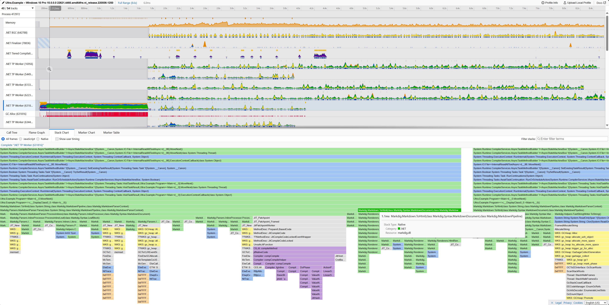

# Ultra [](https://github.com/xoofx/ultra/actions/workflows/ci.yml) [](https://www.nuget.org/packages/Ultra/)


Ultra is an advanced profiler for .NET Applications available on Windows, Linux and macOS (Apple Silicon).

> 📽️ Check this [video](https://vimeo.com/1030852299) for a quick tour of ultra! 📽️

## ✨ Features

- **Sampling profiler** - ETW based on Windows (up to 8190 samples/second), kernel perf events on Linux (up to 8190 samples/second, launch or attach), in-process sampler over EventPipe on macOS ARM64 (up to 1000 samples/second)
- UI based on https://profiler.firefox.com/
  - Traces shareable online: Check this example: ✨ https://share.firefox.dev/3Cya7YW ✨
  - **Timeline** visualization
  - **Flamegraph / Stack Chart** visualization
  - **Call Tree** visualization
  - **Marker Chart** and **Marker Table** visualization  
- Precise **kernel**, **native** and **managed** **function call stacks**
- Categorization of functions: 
  - `.NET`, `.NET JIT`, `.NET GC`, `.NET CLR`, `Native`, `Kernel`
- .NET GC Memory track
- JIT Compile Time Event Markers
  - See which function is getting compiled
- GC Events Markers
  - `GC Allocation Ticks`: Details about allocations. 
  - `GCHeapStats`: Statistics about the GC
  - `GCSuspendEE`, `GCRestartEE`, `GC Start`, `GC Stop` events
- Lightweight trace files - e.g. Generates only a few MB for 10s
- **Built for AI agents and automation**:
  - `ultra mcp`: an MCP server to capture profiles and analyze them (call trees, hotspots, callers, markers...)
  - `ultra guide`: the workflow for agents and scripts, `ultra report`: a text overview of a profile
  - `--elevate` (UAC prompt from a non-admin shell on Windows), `--result-file` (JSON summary), `--stop-file`
- Requires `net8.0+` via dotnet global tool

|Screenshot of a trace generated by ultra visualized with https://profiler.firefox.com. Check this trace online [here](https://share.firefox.dev/3Cya7YW)! |
|-----|
||

## 🧑‍💻 Usage

You need to have installed a [.NET 10.0+ SDK](https://dotnet.microsoft.com/en-us/download/dotnet/10.0)

```console
$ dotnet tool install -g Ultra # The command ultra.exe will be available from your PATH
```

### Windows

> ____
> 🚨 The profiler **requires to run from an elevated prompt with administrative rights** 🚨 
>
> _This is required to allow to collect full stack traces, including kernel and native functions._
> ____

Example: open a **terminal with administrative rights**, to profile an executable called `my_commands.exe`:

```console
$ ultra.exe profile -- my_command.exe arg0 arg1 arg2...
```

> ⚠️ Notice the `--` separator to separate the arguments to `ultra.exe` from the arguments to the profiled application.

From a terminal without administrative rights, add `--elevate`: Windows asks for them with a UAC prompt, and the profiling runs in an elevated ultra relayed to your terminal (a launched program still runs as you, not elevated):

```console
$ ultra.exe profile --elevate -- my_command.exe arg0 arg1 arg2...
```

Profiling a running application just requires the PID of the process to profile:

```console
$ ultra.exe profile 15243 # PID of the process to profile
# Wait for a bit and press only one CTRL+C to stop the profiling
```

### macOS (Apple Silicon)

On macOS, **no elevated privileges are required**. The profiler injects a small sampler library into the launched process to collect native and managed call stacks.

```console
$ ultra profile -- my_command arg0 arg1 arg2...
```

Current limitations on macOS:

- Only **ARM64** (Apple Silicon) is supported.
- Only **launching a program** is supported - attaching to a running process with a PID is not (the sampler library can only be injected at process startup).
- The maximum sampling frequency is 1000 samples/second (`--sampling-interval` minimum is 1ms).
- Kernel call stacks are not collected (user-space native and managed call stacks are).
- Symbols of system libraries living in the dyld shared cache (e.g. `libsystem_pthread.dylib`) are not resolved.

## 🤖 AI agents and automation

`ultra guide` prints the workflow for AI agents and scripts. In short:

```console
$ ultra profile --elevate --duration 30 --result-file result.json --pid 1234   # capture, JSON summary with the profile files
$ ultra report ultra_my_app_..._pid_1234.json.gz                              # text overview: CPU per thread, top functions
```

`ultra mcp` is an MCP server (stdio) that lets your AI coding agent capture profiles (`find_processes`, `start_profiling`, `get_job_status`, `stop_job`...) and analyze them (`get_profile_report`, `call_tree`, `call_tree_inverted`, `find_hotspots`, `focus_function`, `query_markers`...). Configure your agent to start `ultra mcp`, e.g. `claude mcp add ultra -- ultra mcp`, or in `.vscode/mcp.json`:

```json
{ "servers": { "ultra": { "type": "stdio", "command": "ultra", "args": ["mcp"] } } }
```

The analysis tools of `ultra mcp` come from [UltraMcp](https://github.com/KirillOsenkov/UltraMcp) by @KirillOsenkov (MIT license, see [THIRD-PARTY-NOTICES.txt](src/Ultra.Mcp/THIRD-PARTY-NOTICES.txt)).

## 📖 User Guide

For more details on how to use Ultra, please visit the [user guide](https://github.com/xoofx/Ultra/blob/main/doc/readme.md).

## 🪪 License

This software is released under the [BSD-2-Clause license](https://opensource.org/licenses/BSD-2-Clause). 

## 🤗 Author

Alexandre Mutel aka [xoofx](https://xoofx.github.io).
